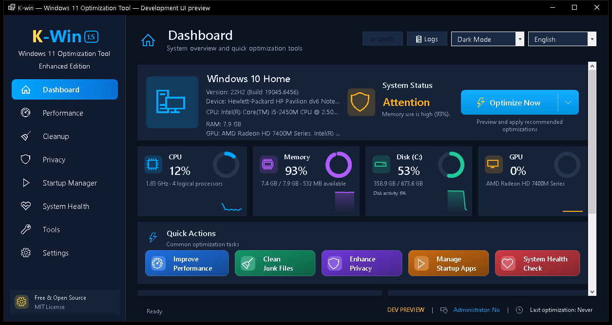
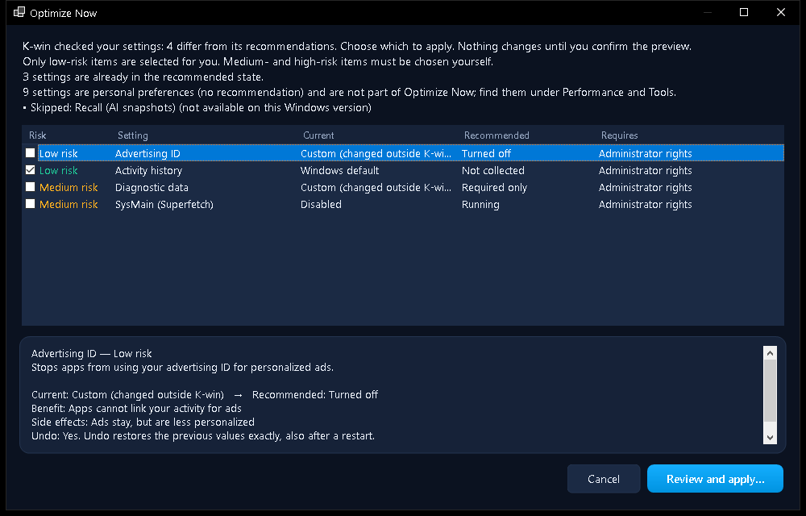
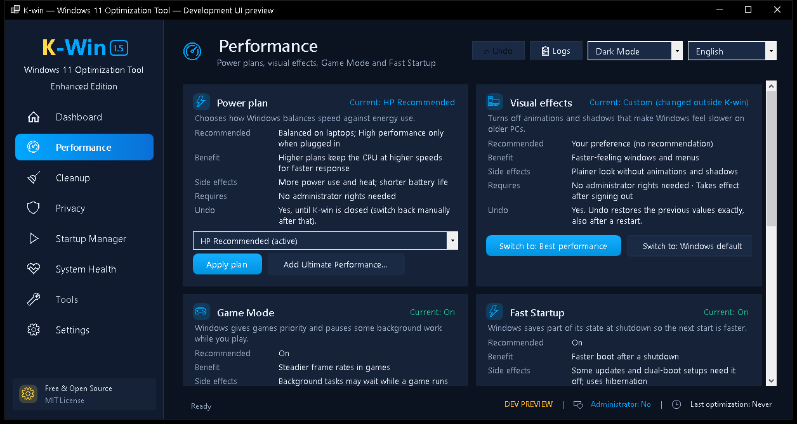
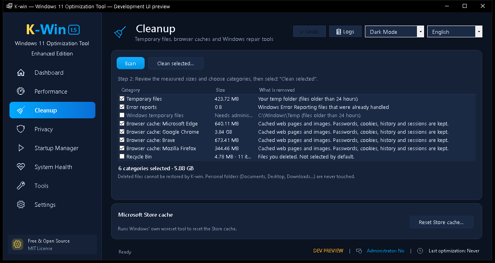
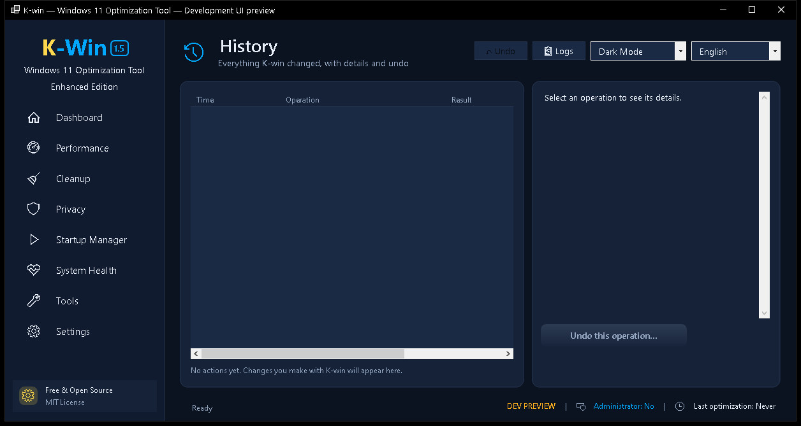
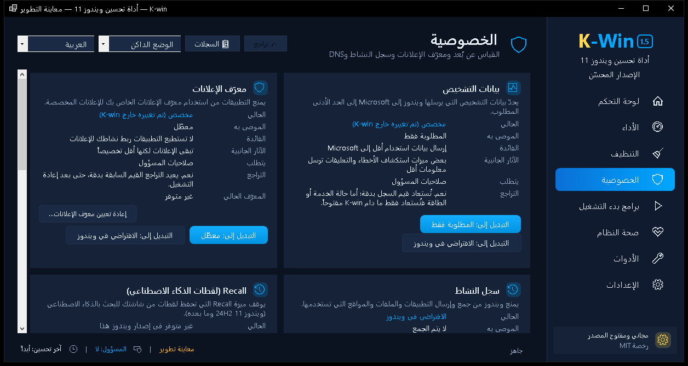

# K-Win 1.5 Enhanced Edition — Windows 11 Optimization Tool


[](https://opensource.org/licenses/MIT)

<p align="center">
  
</p>

A safe, transparent Windows 11 optimization tool focused on performance, privacy, and cleanup.
Built with C# and .NET 8 Windows Forms.

## 📥 Download

[](https://github.com/Elomami1976/K-Win/releases/latest)

**[⬇️ Download the latest release](https://github.com/Elomami1976/K-Win/releases/latest)**: one portable file, `K-Win-1.5.0.exe` (Windows x64, self-contained, nothing to install). Each release lists the file's SHA-256 checksum so you can verify the download:

```powershell
Get-FileHash .\K-Win-1.5.0.exe -Algorithm SHA256
```

> **⚠️ Windows SmartScreen notice:** the app is not code-signed, so Windows may show **"Windows protected your PC"**. This is not a virus detection. Click **More info** → **Run anyway**, or right-click the file → **Properties** → **Unblock**. K-Win is open source, so you can review or build the code yourself.

## 🆕 What's new in 1.5 Enhanced Edition

- **New interface:** sidebar navigation, a dashboard with live CPU / memory / disk / GPU monitoring, dark and light themes.
- **Optimize Now:** analyzes your real settings, groups recommendations by risk, pre-selects only low-risk items, previews every change and applies them one by one with a single undo.
- **History page:** every operation with original → new values, and per-operation undo when it is safe.
- **Runs without administrator rights.** K-Win asks to restart as administrator only for changes that need it.
- **Safer changes:** verified registry backups, read-back verification, precise rollback, junction-safe cleanup. Settings managed by your organization or by local Group Policy are shown read-only.
- **Startup Manager** with Task Manager-compatible enable/disable (nothing is deleted).
- **English, Français and العربية** (full right-to-left layout).
- **Optional update check** (off by default; reads only GitHub's public release information and never downloads anything).

See [CHANGELOG.md](CHANGELOG.md) for the full list.

## 🖼️ Screenshots

| Dashboard | Optimize Now |
|---|---|
|  |  |
| **Performance** | **Cleanup** |
|  |  |
| **History** | **Privacy (Arabic)** |
|  |  |

*Screenshots were taken on Windows 10 with the developer-only read-only preview, which is why the title bar says "Development UI preview". The released app does not show this label.*

## ✨ Features

### ⚡ Performance
- Power plans (Balanced / High Performance / Ultimate Performance)
- Visual effects, Game Mode, Fast Startup, menu delay, shutdown timeouts
- Memory compression status (measured as administrator, inferred otherwise)
- Startup Manager

### 🔒 Privacy
- Diagnostic data (telemetry) set to the minimum allowed level
- Advertising ID, Activity history, Windows Recall (Windows 11 24H2+)
- DNS provider selection, with "Automatic (DHCP)" to restore

### 🧹 Cleanup
- Measured preview of temporary files, error reports, browser caches (Edge, Chrome, Brave, Firefox) and the Recycle Bin (not selected by default)
- Cancel at any time; a report of what was deleted
- Passwords, cookies, browsing history and personal folders are never touched
- Microsoft Store cache reset, SFC and DISM

## 🛡️ Safety

- A restore point before system changes (Windows allows one every 24 hours; K-Win says when a recent one is reused)
- A registry backup (.reg) before each change, and read-back verification after it
- Undo for registry changes (kept across restarts); History shows exactly what changed
- No registry cleaner; Windows Defender and Windows Update are never disabled
- No telemetry, ads or accounts; works offline

### Limitations to know
- **File deletions (cleanup, activity data) cannot be undone.** The preview says so before you confirm.
- **Service and power-plan steps** can be undone only while K-Win stays open. Registry changes can be undone at any time. History shows which applies.
- A setting set by your organization or by local Group Policy is shown but not changed.
- Some technical error details from Windows appear in English inside translated messages.

For technical details, see [SAFETY.md](SAFETY.md).

## ⚠️ Windows 11 testing status

K-Win 1.5 was built and tested on **Windows 10 (build 19045)** with 168 automated tests and the read-only preview. **It has not yet been validated on Windows 11** (real PC or virtual machine), and not at 125% / 150% display scaling. The manual test plan is in [WINDOWS11_VALIDATION_CHECKLIST.md](WINDOWS11_VALIDATION_CHECKLIST.md). Create a restore point or VM snapshot before trying it, and please report problems in [Issues](https://github.com/Elomami1976/K-Win/issues).

## 🚀 Getting Started

1. Download `K-Win-1.5.0.exe` from the latest release.
2. Double-click it. No administrator prompt appears; pick your language.
3. Use **Optimize Now** on the dashboard, or change individual settings on each page.
4. Review the preview and confirm. When a change needs administrator rights, K-Win offers to restart elevated.
5. Restart Windows if prompted.

## ✅ Requirements

- **OS:** Windows 11 (22H2, 23H2, 24H2), x64
- **Privileges:** a standard user account to start; administrator only for system-wide changes
- **Runtime:** none (self-contained)

## 🏗️ Build from Source

### Prerequisites
- Visual Studio 2022 (17.8+) with ".NET desktop development" workload
- .NET 8 SDK

### Build
```bash
dotnet build -c Release
```

### Tests
```bash
dotnet test Tests/KWin.Tests
```

### Publish (single-file EXE)
```bash
dotnet publish K-win.csproj -c Release -r win-x64 --self-contained true -p:PublishSingleFile=true -p:DebugType=none -o ./publish
```
Trimming is not used: Windows Forms does not support it.

## ❓ Troubleshooting

**“Windows protected your PC” (SmartScreen)**
→ Click **More info** → **Run anyway** (the app is unsigned but open source)
→ If there's no **Run anyway** button: right-click `K-win.exe` → **Properties** → check **Unblock** → **OK**

**“A change asks for administrator rights”**
→ Accept the restart as administrator; K-Win reopens on the same page

**“How do I undo changes?”**
→ Use **Undo** in the top bar, **Undo this operation** on the History page, or a System Restore Point

## 🧪 Testing

See `TESTING.md` for a full validation checklist.

## 🤝 Contributing

Contributions are welcome.
You can open issues, suggest improvements, or submit pull requests.

---

<p align="center">
	<a href="https://elomami1976.github.io/K-Win/">🌐 Website</a> •
	<a href="https://github.com/Elomami1976/K-Win/releases">⬇️ Download</a> •
	<a href="https://github.com/Elomami1976/K-Win/issues">🐛 Report Bug</a>
</p>
